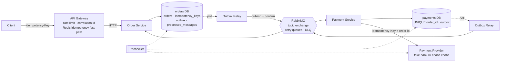
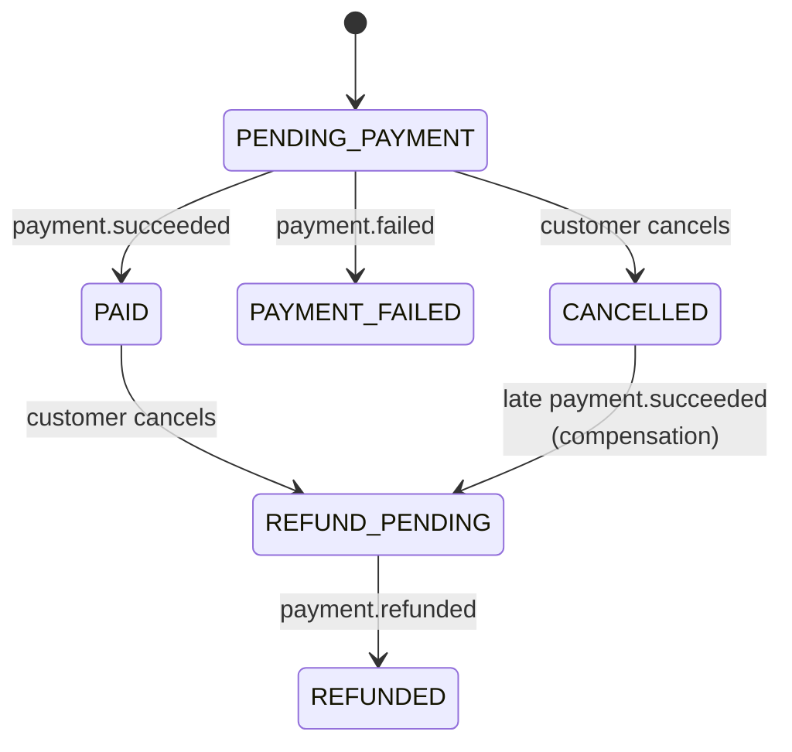
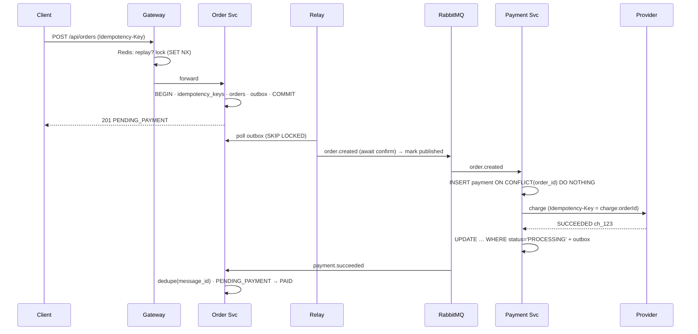

# Payment-Safe Order Processing

A distributed order + payment system built to answer one question:

> **Does it still charge every customer exactly once when things break?**

Duplicate requests, retry storms, crashed services, a message broker that redelivers, a payment provider that times out *after* taking the money. This repo doesn't just claim correctness; it **injects those failures and proves the books balance** with an automated reconciliation against the provider's ledger.

```
7 chaos scenarios · 0 double charges · 0 lost orders · 0 reconciliation mismatches
```

And when the protection is deliberately switched off, the same tests catch **137 violations** (double charges) in one run, which shows the tests actually have teeth.

---

## Architecture



| Component | Responsibility |
|---|---|
| **Gateway** | Single entry point. Rate limiting, correlation IDs, Redis idempotency fast path (replay completed requests, `409` concurrent duplicates). Fails **open** if Redis is down. |
| **Order Service** | Owns orders and an explicit state machine. Writes order + idempotency record + outbox event in **one transaction**. Saga participant for payment results. |
| **Payment Service** | Charges/refunds via the provider. Three independent double-charge guards (see below). |
| **Outbox Relay** (×2) | Publishes outbox rows with broker confirms; `FOR UPDATE SKIP LOCKED` so it can scale out. |
| **Payment Provider** | A fake bank that behaves like a real one: idempotent by key, and can be told to decline, 503, or *succeed but reply too late*. Its ledger is the source of truth for reconciliation. |
| **Reconciler** | Checks 8 money invariants across all three ledgers. Exit code 0/1, so it's CI-able. |

### Order lifecycle (saga)



### Happy path



---

## How double charges are prevented

| Layer | Mechanism | Protects against |
|---|---|---|
| Gateway | Redis `SET NX` lock + cached response | Retry storms hammering the DB; fast replays |
| Order Service | `idempotency_keys` PK inserted **in the same transaction** as the order; request hash check (`422` on key reuse with a different body) | Duplicate orders even if Redis is down or evicted |
| Outbox | Order + event committed atomically | "Saved to DB but event never sent" (dual-write) |
| Consumers | `processed_messages(message_id)` written in the same transaction as the state change | Broker redelivery (RabbitMQ is at-least-once) |
| Payment Service | `UNIQUE(order_id)` on payments | Duplicate `order.created` creating two payments |
| Provider call | Idempotency key = `charge:<orderId>` | Retry after a timeout charging twice, the classic "ghost charge" |
| Finalisation | `UPDATE … WHERE status = 'PROCESSING'` | Two concurrent workers both emitting `payment.succeeded` |
| Reconciler | Compare orders ↔ payments ↔ provider ledger | Anything the above missed, *detected*, never silent |

---

## Quick start

```bash
docker compose up --build -d          # everything, incl. Prometheus + Grafana
npm install                           # for chaos/reconcile scripts on the host

curl -X POST localhost:3000/api/orders \
  -H 'Content-Type: application/json' -H 'Idempotency-Key: demo-1' \
  -d '{"customerId":"c1","amountPaise":49900}'

curl localhost:3000/api/orders/<id>   # includes full status history
npm run reconcile
```

| URL | What |
|---|---|
| http://localhost:3000 | API gateway |
| http://localhost:3030 | Grafana dashboard "Payment-Safe Order Processing" |
| http://localhost:15672 | RabbitMQ UI (guest / guest): watch retry queues and DLQs |
| http://localhost:9090 | Prometheus |

**No Docker?** With local Postgres, Redis and RabbitMQ running: `scripts/local.sh up` (supervised processes that auto-restart, like `restart: unless-stopped`).

### API

| Method | Path | Notes |
|---|---|---|
| `POST` | `/api/orders` | Body `{customerId, amountPaise}`. **`Idempotency-Key` header required.** `201` new or replayed (`idempotent-replay: true`), `409` same key in flight, `422` key reused with different body |
| `GET` | `/api/orders/:id` | Order + status history |
| `POST` | `/api/orders/:id/cancel` | Idempotent. Pending → `CANCELLED`; paid → refund saga |

Money is stored as integer **paise** (`BIGINT`), never floats.

---

## Chaos testing

```bash
npm run chaos          # all 7 scenarios, reconciliation after each
bash chaos/run-all.sh 4   # just one
```

Every scenario wipes data, injects a failure under load, then runs the reconciler, which waits for in-flight work to settle and **fails if a single paisa is out of place**.

| # | Failure injected | Result |
|---|---|---|
| 1 | 50 orders × **100 concurrent copies** of the same request (5,000 requests) | 50 orders, 50 charges, 0 mismatches |
| 2 | **Payment service down 8 s** at 40 rps with client retries | All orders processed after recovery, 0 lost |
| 3 | **Outbox relay crashes after publishing, before marking published** (5 crashes) | Events re-sent; duplicates absorbed by consumers; 0 mismatches |
| 4 | Provider returns **20 % 503s + 25 % "ghost timeouts"** (charged, reply arrives after client timeout) | ~130 payments per run needed provider retries, still exactly 1 charge each |
| 5 | **Redis stopped**, duplicate storm of 1,500 requests | 30 keys → 30 orders. Postgres backstop held |
| 6 | **Cancel while charge in flight** (50 % of orders cancelled) | ~90–100 compensating refunds per run; captured money == PAID orders |
| 7 | Rolling **kill -9** of order service, payment service and a relay under load | 597 orders, 0 mismatches |

Sample reconciliation output:

```
──────── RECONCILIATION ────────
orders            597
by status         {"PAID":537,"PAYMENT_FAILED":60}
provider charges  597
captured (₹)      1345562.00
PAID orders (₹)   1345562.00
mismatches        0
RESULT: PASS ✓
```

### Proving the tests have teeth

```bash
# restart payment-service with the provider idempotency key randomised
UNSAFE_RANDOM_PROVIDER_KEY=1 docker compose up -d payment-service
bash chaos/run-all.sh 4
#  mismatches        137
#  ✗ I1 double charge 0b2ca4b1-… 2 successful charges
#  ✗ I1 double charge edf701c8-… 4 successful charges
```

Turn one guard off and the system double-charges under timeouts, and the reconciler catches every one.

### Reconciliation invariants

| | Invariant |
|---|---|
| I1 | No order has more than one successful provider charge |
| I2 | `PAID` ⇒ one `SUCCEEDED` payment + one captured charge of the same amount |
| I3 | `PAYMENT_FAILED` ⇒ no successful charge |
| I4 | `REFUNDED` ⇒ refunded in our ledger **and** at the provider |
| I5 | `CANCELLED` ⇒ no captured money (after compensation settles) |
| I6 | No provider charge for an order we don't know |
| I7 | Total captured at provider == total of `PAID` orders, to the paisa |
| I8 | Nothing stuck: no pending orders past a timeout, outbox drained |

---

## Load testing

```bash
k6 run -e RATE=200 load/k6-orders.js   # ramp → hold → reconcile afterwards
```

Baseline measured on a **2-vCPU sandbox with every service, Postgres, Redis and RabbitMQ on the same box** (re-run on your own hardware before quoting numbers):

| Target rate | p50 | p95 | p99 | Errors | Reconciliation |
|---|---|---|---|---|---|
| 100 rps | 78 ms | 252 ms | 330 ms | 0 % | PASS |
| 200 rps | saturated (2.3 s p50, client retries kick in) | | | | PASS |
| 800 rps | heavily overloaded, 74 % of requests fail fast/timeout | | | | **PASS, still 1 order per key, 0 double charges** |

The interesting result is the last row: past saturation the system gets **slow, not wrong**. See [`BENCHMARKS.md`](BENCHMARKS.md) for the methodology and the tuning log.

---

## Observability

- **Structured JSON logs** with a `correlationId` that flows gateway → order → outbox → RabbitMQ headers → payment → provider. `grep` one ID to see an order's entire life.
- **Prometheus metrics**: HTTP latency histograms, idempotency replays/409s, duplicates absorbed per consumer, retry/DLQ counts, outbox backlog, provider outcomes.
- **Grafana** dashboard provisioned automatically.
- `GET /api/orders/:id` returns the full **status history** with reasons (`charge ch_…`, `payment succeeded after cancellation (compensation)`).

## Project layout

```
services/
  gateway/           rate limit, correlation id, Redis idempotency fast path
  order/             state machine, idempotent create, saga handlers
  payment/           charge/refund with 3 double-charge guards, provider client
  relay/             transactional outbox publisher (generic, one per DB)
  payment-provider/  fake bank with runtime chaos knobs
shared/              db tx/outbox/dedupe, RabbitMQ topology (retry + DLQ), metrics, logs
db/                  schema per service database
chaos/               failure scenarios + runner
scripts/             migrate, reconcile, load generator, docker-less runner
load/                k6 script
monitoring/          Prometheus + Grafana provisioning
tests/               unit tests
```

Design decisions and trade-offs: **[DESIGN.md](DESIGN.md)**
